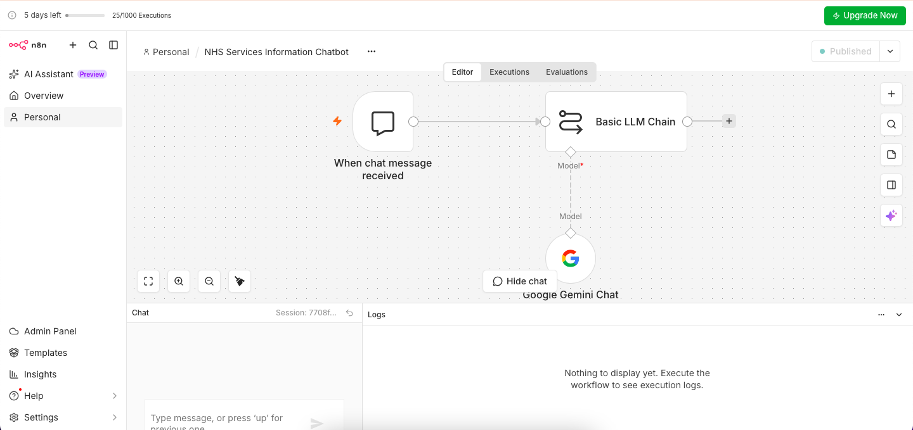

# NHS Services Information Chatbot

An n8n workflow that provides a simple **demonstration chatbot** for answering general questions about NHS services in England, powered by Google Gemini.

> **Disclaimer:** This is a demonstration project only. It is **not** an official NHS service, is not affiliated with the NHS, and must not be used for medical advice, diagnosis or treatment. In an emergency call **999**; for urgent medical help visit [NHS 111](https://111.nhs.uk/).

## Features

- Chat interface hosted by n8n (public chat widget via webhook)
- Clear, simple answers about NHS services
- Safety guardrails built into the system prompt:
  - No diagnosis or prescribing medicines
  - Does not claim to be an official NHS representative
  - Directs urgent concerns to NHS 111 and emergencies to 999
  - Does not ask for NHS numbers, passwords or sensitive medical information
  - States that it is a demonstration chatbot
  - Says when it cannot confirm an answer
  - Includes a relevant official NHS webpage where available

## Architecture

| Node | Purpose |
|------|---------|
| **When chat message received** | n8n Chat Trigger (webhook mode) that receives the user's message |
| **Basic LLM Chain** | Applies the NHS assistant system prompt and generates the reply |
| **Google Gemini Chat Model** | LLM powering the chain |

Flow: `When chat message received → Basic LLM Chain` (with `Google Gemini Chat Model` attached as the model)

## Prerequisites

- An [n8n](https://n8n.io) instance (cloud or self-hosted)
- A **Google Gemini API key** from [Google AI Studio](https://aistudio.google.com/)

## Setup

1. **Import the workflow**
   In n8n go to *Workflows → Import from File* and select `NHS_Services_Information_Chatbot.json`.
2. **Add credentials**
   Credentials are intentionally **not included** in this repository. Open **Google Gemini Chat Model** and create a *Google Gemini (PaLM) API* credential with your own API key.
3. **Test it**
   Click **Open chat** in the editor and ask a question such as *"How do I register with a GP?"*
4. **Publish** the workflow when you are ready to use the public chat URL.

## Example Questions

- "How do I find an NHS dentist?"
- "What is the difference between NHS 111 and 999?"
- "How do I register with a GP?"

## Limitations

- The chatbot has **no connected knowledge source**. The prompt asks it to use reliable NHS information, but answers come from the model's general knowledge and may be out of date or incorrect. Always check the official NHS website.
- No conversation memory is configured, so each message is handled independently.
- The chat trigger is set to **public**, so anyone with the link can use it and consume your Gemini API quota.

## Security Notes

This repository contains a sanitized workflow.

- Credentials, webhook IDs, instance ID and workflow/version IDs have been removed.
- Never commit API keys or tokens.
- If you publish the chat publicly, consider rate limiting or enabling authentication on the Chat Trigger.

## Possible Improvements

- Ground answers in official NHS content using RAG (e.g. a vector store built from NHS website pages)
- Add conversation memory
- Add authentication or rate limiting to the public chat
- Add a fallback node to log unanswered questions
- Add NHS.uk API integration for service search
